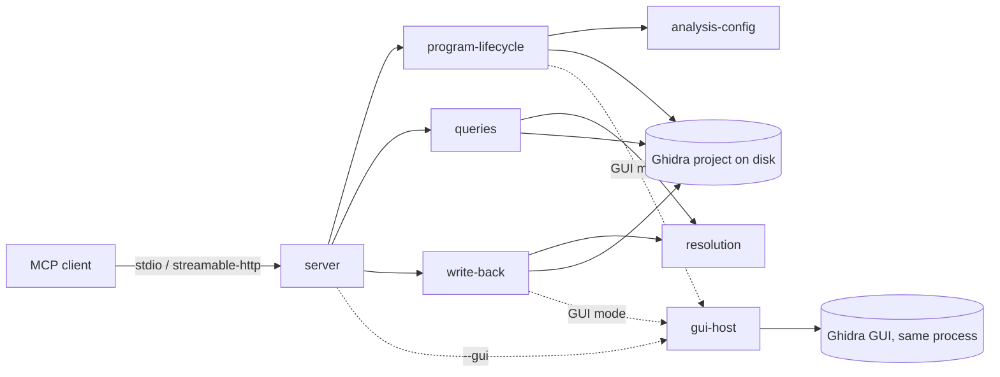

# High-Level Design: ghidra-mcp-lite

*Brownfield skeleton generated by `/map-codebase` on 2026-10-03 from git SHA `1acf6ba`. Sections marked* not yet specified *are open for authoring. Statements cite the README (by section) when the project states them, and are marked `[inferred]` when they were deduced from code.*

## Problem

Ghidra MCP servers built on embeddings and vector indexes saturate the CPU on startup when run on small VMs (README introduction). An LLM agent doing reverse engineering on modest hardware, such as a t3.small, needs Ghidra's analysis capabilities without that overhead.

*(Who suffers and why now: not yet specified.)*

## Approach

A lightweight MCP server that runs Ghidra inside the Python process via pyghidra, and exposes native Ghidra capabilities as 35 MCP tools (38 in GUI mode), with no ChromaDB, ML model, or vector indexing (README introduction; package description). Ghidra runs headless by default; GUI mode hosts the Ghidra GUI in the same process.

- **Persistent project, reused analysis.** Binaries are imported into an on-disk Ghidra project and analyzed once. Later startups reuse that analysis; the `reanalyze_binary` tool re-runs it on request (README § How It Works).
- **Serve early, gate per binary.** The server answers the MCP handshake immediately and analyzes in the background. A tool call for a binary that isn't ready waits up to 45 s for it, by default and with no client configuration. If the binary is still not ready, the call returns `retry_later`, saying how long its analysis has been running or that it is queued. `--analyze-only` pre-analyzes binaries and exits, so that later starts are instant.
- **Read and write.** Clients can explore a binary (listings, searches, decompilation, cross-references, callers and callees, call graphs, p-code, data-flow slices, function diffs, and fuzzy similarity search) and record their understanding back into the project (renames, comments, types, prototypes), saved immediately (README § Tool Reference).
- **GUI mode (`--gui`).** The server starts the Ghidra GUI inside its own process with its project open, and serves MCP over HTTP alongside it. Tools work on the same in-memory programs CodeBrowser shows, so the analyst watches edits appear live. Analysis is Ghidra's own, edits are applied without saving (the analyst saves and can undo them), and three GUI-only tools — the current function, the current address, and navigating the GUI to an address — let the analyst and the agent point at the same place. See [the GUI integration decision](decisions/gui-integration.md).

## Target Users

Reverse engineers and the LLM agents working for them, through MCP clients such as Claude Code, GitHub Copilot, and Cline (README § MCP Client Configuration). They run either locally over stdio for desktop RE, against a remote headless VM over HTTP (README § Quick Start), or locally in GUI mode when the analyst wants to watch and steer the agent's work in Ghidra's GUI.

*(Needs and cost sensitivities: not yet specified.)*

## Goals

- **Reliable for reverse engineers and their agents.** Every call returns accurate information, and every failure is explicit, within the limits of what the Ghidra API exposes.
- **Current platform.** Support Ghidra 12.1 or later (12.1.4 is current), which requires JDK 21 or later, and Python 3.11 through 3.14. Python 3.11 is the floor because the MCP Python SDK requires 3.10 or later and 3.10 reaches end-of-life in October 2026. 3.14 is the newest Python that Ghidra 12.1's PyGhidra supports. The server is built on MCP Python SDK 2.x.

Stated in the project, to be confirmed:
- Run comfortably on a small VM such as a t3.small (README introduction).
- Reload already-analyzed projects without re-analysis (README § How It Works).

- **GUI mode is a supported, opt-in mode.** It offers every headless tool plus the GUI-only ones, with documented differences. Its logic is covered by the regular unit tests; the GUI itself is exercised by an on-demand smoke suite rather than on every change.

Deferred to a later version:
- **Bounded, stable responses.** Results are size-bounded and deterministically ordered, with explicit totals and continuation, so large outputs (cross-references, disassembly, symbol searches) fit an agent's context. The first version does not standardize pagination.

*(Measurable success targets: not yet specified.)*

## Non-Goals

- **No ML, embeddings, or vector search.** All search uses Ghidra's native iterators (README introduction).
- **No interactive-GUI tools in headless mode.** `get_current_function`, `get_current_address`, and `go_to` need a Ghidra GUI session; they exist only in GUI mode.
- **GUI mode serves one project, one analyst, over HTTP.** It does not follow the analyst to another project, does not support stdio, and is not a multi-user setup (a shared Ghidra Server repository is the route for that).
- **No authentication** for the HTTP transports (see the server LLD).

## Tenets

Ordered: when two conflict, the higher one wins.

- **Never guess for the caller.** Resolve a target only when the match is unambiguous. A read tool may accept a unique loose match (a partial name, a plain name inside a namespace, an address inside a function) if its response states what it resolved to. A write tool acts only on an exact match and otherwise returns the candidates.
- **Explicit over silent.** When a call cannot produce a complete, correct result, the response says so: an error, or a partial result with each failed item marked. Where Ghidra itself gives no signal, document the blind spot rather than imply certainty.
- **Actionable failures.** Every failure tells the caller which recovery applies (fix the input, retry later, or stop), so an agent can act without parsing prose.
- **The analyst stays in control.** When the analyst and the agent would pull in different directions — the cursor, the view, unsaved work, analysis runs — the analyst wins. The agent changes what the analyst sees only when explicitly asked to, and never saves or discards the analyst's work.
- **Reliability over footprint.** When correct, explicit results cost memory or CPU, pay it. The small-VM goal still rules out heavyweight approaches such as ML and vector indexes, and breaks ties between equally correct options.

## System Design

The system decomposes into seven segments, each owning a distinct set of rules (a behavioral-boundary lens). Six serve both modes; `gui-host` exists only in GUI mode and plugs into program-lifecycle and write-back through seams, so headless behavior does not depend on it:

| Segment | Owns | LLD |
|---|---|---|
| server | CLI, MCP server app, tool registry, failure categories, logging, packaging | `docs/intent/server/server-design.md` |
| program-lifecycle | Project, program registry, import, analysis scheduling, the analysis gate, deletion, shutdown | `docs/intent/program-lifecycle/program-lifecycle-design.md` |
| analysis-config | PDB/symbol setup, GDT archives, typed analyzer options | `docs/intent/analysis-config/analysis-config-design.md` |
| resolution | Turning caller strings into addresses, functions, symbols, data types | `docs/intent/resolution/resolution-design.md` |
| queries | 22 read-only tools and their response models | `docs/intent/queries/queries-design.md` |
| write-back | 8 write tools under a transaction-and-save contract | `docs/intent/write-back/write-back-design.md` |
| gui-host | GUI mode: launching the Ghidra GUI in-process, binding to its project, opening programs in CodeBrowser, delegating analysis to Ghidra, Swing-thread execution of writes, the GUI save policy, and the GUI-only tools | `docs/intent/gui-host/gui-host-design.md` |

### Cross-cutting concerns

- **Threading.** SDK 2.x runs tool calls on parallel worker threads. Ghidra access is serialized by per-program locks, with short project-operations and registry locks taken after them, and background import and analysis share one worker (program-lifecycle, LIFE-024/025/041). In GUI mode, anything touching GUI state (CodeBrowser, navigation, the current location) runs on the Swing thread, and each write runs there as its own transaction, only when no other transaction is open on the program, because Ghidra merges overlapping transactions and aborts them together (gui-host).
- **Failure categories.** Every failure carries one recovery category: `fix_input`, `retry_later`, or `stop`. In SDK 2.x only a raised `ToolError`'s message reaches the model, so every failure is raised as a `ToolError` whose message starts with `[category]`. The client sees it after the SDK's `Error executing tool <name>: ` prefix. Unexpected exceptions become `[stop] Internal error…`, with details only in the server log. The taxonomy is defined in the server LLD and adopted by every segment.
- **Resolution disclosure and partial results.** A read tool that resolved a loose match states what it resolved to (resolution, queries). A call that partly fails returns what succeeded, with each failed item marked (queries). Program status (importing, analyzing, ready, failed), failure reasons, and configuration warnings are visible in the project listing (program-lifecycle, analysis-config, server). In GUI mode, Ghidra's analysis manager reports only that analysis ended or was cancelled, not analyzer failures; this blind spot is documented (gui-host).
- **Decompiler use.** One `DecompInterface` per program is shared by decompile, variable rename, and retype, under the program's lock. Timeouts are 120 s for decompile and 30 s for variable edits.
- **Optional `ghidrecomp`.** An optional extra, used for call graphs and PDB/symbol-server setup. Without it, call graphs fail with `stop` and symbol configuration is skipped with a configuration warning (SRV-029, ACFG-018).
- **Testing.** Each segment has Ghidra-free unit tests against fakes (`tests/`), and an integration suite runs the tools against a real Ghidra when `GHIDRA_INSTALL_DIR` is set (`tests/integration/`). A GUI smoke suite, run on demand, launches GUI mode with isolated Ghidra settings and drives it over HTTP. Tests cite the EARS specs they verify with `@spec`.

## Key Design Decisions

Synthesized from the segment LLDs. Each LLD's *Decisions & Alternatives* table carries the detail.

- **Native Ghidra only, no semantic index.** This keeps the server light enough for small VMs. Fuzzy function similarity is a transparent heuristic over instruction sequences, not a learned model. See queries.
- **Persist the project and reuse analysis.** Analysis is expensive, so it runs once per binary unless `reanalyze_binary` requests it again. See program-lifecycle.
- **Serve before analysis completes, and gate each binary.** Clients connect immediately. A call for an unfinished binary waits up to 45 s, which keeps it under typical client tool-call timeouts, and then returns `retry_later`, instead of startup blocking, which would trip stdio clients' startup timeouts. See program-lifecycle and server.
- **Analysis options belong to binaries.** A PDB path, GDT archives, analyzer options, and whether to use symbols are arguments of `import_binary` and `reanalyze_binary`, not server-wide flags. A PDB matches exactly one binary, and an agent can tune or retry one binary's analysis without restarting the server. See program-lifecycle and analysis-config.
- **Open lazily, serialize per program.** Programs open on first use. Per-program locks let calls on ready binaries proceed while another binary is analyzed. See program-lifecycle.
- **One transaction and save per write.** Edits are atomic and durable immediately. See write-back.
- **One string, name or address, resolved without guessing.** `[inferred]` One parameter keeps the tool surface small for LLM clients. Read tools resolve a unique loose match and disclose it; write tools require an exact match; anything else fails with candidates. See resolution.
- **Content-hashed program names** `<file>-<sha1[:6]>`, so the same filename from different paths can coexist. See program-lifecycle.
- **GUI integration by hosting the GUI in-process.** One process, one in-memory program shared by the GUI and the tools, rather than a Java plugin with a bridge or a shared Ghidra Server repository. Only this keeps a single Python implementation of the tools while making edits live. See [the GUI integration decision](decisions/gui-integration.md) and gui-host.
- **In GUI mode, the analyst owns saving and analysis.** Writes are applied but not saved, so they never save the analyst's own unsaved work and each can be undone; analysis runs through Ghidra's analysis manager, with its progress and controls. See gui-host.

## Success Metrics

*(not yet specified)*

## FAQ

*(not yet specified)*

## References

- User documentation: `README.md`
- Arrow overlay: `docs/arrows/index.yaml` and per-segment arrow docs in `docs/arrows/`
- Segment LLDs and EARS specs: `docs/intent/<segment>/`
- Project-level decisions: `docs/decisions/` ([GUI integration](decisions/gui-integration.md))
- External: [pyghidra](https://pypi.org/project/pyghidra/), [ghidrecomp](https://pypi.org/project/ghidrecomp/), [Model Context Protocol Python SDK](https://pypi.org/project/mcp/), [Ghidra](https://ghidra-sre.org)
- Platform requirements: [Getting Started with Ghidra 12.1](https://ghidradocs.com/12.1_PUBLIC/GettingStarted.html) (JDK 21 minimum; Python 3.9–3.14 supported)
